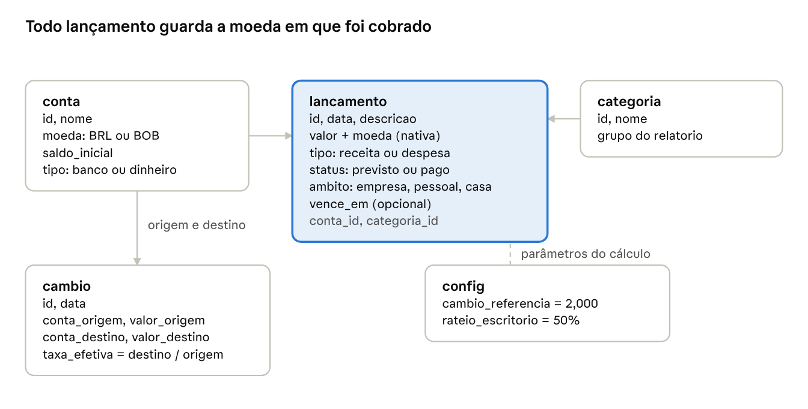
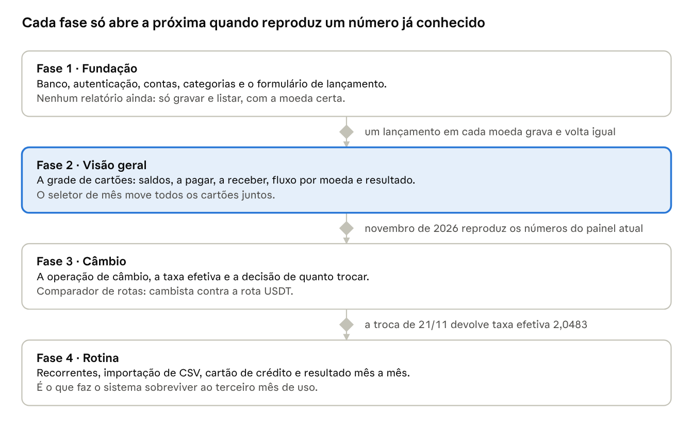

# PRD — Sistema financeiro multimoeda

Royal Marketing · 22 de novembro de 2026 · Kaio Bezerra

Um sistema de controle financeiro para quem fatura em uma moeda e vive em outra: todo lançamento guarda a moeda em que foi realmente cobrado, cada conta fecha no seu próprio saldo, e a conversão só aparece onde é decisão — na hora de trocar. É o recurso que os apps brasileiros cobram caro ou não têm, e é o que torna este sistema necessário.

---

## 1. Problema e objetivo

Nenhum app financeiro do mercado trata duas moedas como duas realidades: todos convertem tudo para uma só.

A Royal Marketing fatura em real e a vida do dono acontece em boliviano, em Santa Cruz. Em novembro de 2026 saíram R$ 7.552,66 no mês — 31% da empresa, cobrados em real, e 69% pessoais, cobrados em boliviano. São dois caixas de moedas diferentes que só se tocam na hora de comprar boliviano.

Os apps brasileiros resolvem isso mal ou caro. O Meu Dinheiro cobra o recurso "contas em outras moedas" a partir de R$ 94,90/mês no plano empresarial e R$ 28,90/mês no pessoal. Mesmo assim, trata a segunda moeda como uma conta convertida por uma taxa fixa.

Taxa fixa é a raiz do erro. Usar 2,00 Bs por real como referência enquanto a compra real sai a 2,048 produziu R$ 301,78 de diferença inexplicada em um único mês.

**O objetivo.** Cada lançamento guarda a moeda em que foi realmente cobrado. Cada conta fecha no seu próprio saldo, sem conversão. A conversão aparece em um lugar só: a decisão de quanto trocar, ao câmbio que será pago de fato.

---

## 2. Usuário e escopo

Um usuário só, com duas vidas financeiras na mesma conta.

Kaio Bezerra é dono da Royal Marketing, uma agência de tráfego pago. Fatura clientes no Brasil em real e mora em Santa Cruz de la Sierra, onde paga aluguel, mercado e transporte em boliviano. O escritório é a casa: metade dela entra como despesa da empresa.

O sistema não é multi-usuário nem multi-empresa. Ele separa empresa e pessoal por rateio dentro da mesma conta, que é um problema diferente e mais simples.

| Área funcional | Escopo | Por quê |
| --- | --- | --- |
| Lançamentos em duas moedas | Entra na v1 | O núcleo: sem isso o resto não faz sentido |
| Contas e saldos por moeda | Entra na v1 | Cada moeda fecha sozinha |
| Contas a pagar e a receber | Entra na v1 | Responde quanto devo e quanto me devem |
| Rateio empresa e pessoal | Entra na v1 | Metade da casa é escritório |
| Câmbio e decisão de troca | Entra na v1 | A única ponte entre as duas moedas |
| Fluxo de caixa por moeda | Entra na v1 | Uma linha por moeda, nunca somadas |
| Resultado do mês | Fase 2 | Depende de ter histórico de meses |
| Lançamentos recorrentes | Fase 2 | Aluguel, assinaturas e faculdade repetem |
| Importação de extrato CSV e OFX | Fase 2 | Hoje o lançamento é manual |
| Cartão de crédito com fatura | Fase 2 | O cartão do Mercado Pago já confunde o caixa |
| Integração bancária automática | Fora do escopo | Open Finance não alcança banco boliviano |
| Multi-usuário e permissões | Fora do escopo | Um usuário só |
| DRE contábil e emissão fiscal | Fora do escopo | É trabalho do contador, não do sistema |

O resultado do mês sai na fase 2, junto com a Visão geral, mas só fica útil a partir do segundo mês de uso.

---

## 3. Regras de moeda e câmbio

Esta seção é o contrato do sistema: implementada errado, nada mais fecha.

**1. Todo lançamento guarda a moeda em que foi cobrado.** Uma corrida de Yango de Bs 248 é gravada como valor 248 e moeda BOB. O sistema nunca grava a conversão junto com o lançamento, porque a taxa de hoje não é a de amanhã.

**2. Toda conta tem exatamente uma moeda.** O saldo de uma conta sempre aparece na moeda dela. Não existe saldo total somando moedas sem dizer a taxa.

**3. Existem dois câmbios, e eles nunca se misturam.**

| Câmbio | Para que serve | Onde é usado | Valor atual |
| --- | --- | --- | --- |
| Referência | Comparar o que não é comparável | Resultado do mês, rateio empresa e pessoal, gráficos de composição | 2,000 Bs por real |
| Efetivo | Decidir quanto trocar de verdade | Quanto comprar de boliviano, apuração de ganho ou perda cambial | 2,048 Bs por real |

O câmbio de referência é um parâmetro editável nas configurações. O efetivo vem da última operação de câmbio registrada, e pode ser sobrescrito pelo usuário antes de uma troca.

**4. A operação de câmbio é um tipo de lançamento próprio, nunca uma despesa.** Ela sai de uma conta e entra em outra. Na troca de 21/11/2026 saíram R$ 3.200,00 da conta em real e entraram Bs 6.554,60 na conta em boliviano. A taxa efetiva é 6.554,60 dividido por 3.200, igual a 2,0483, e fica gravada na operação.

**5. Nenhuma tela soma moedas diferentes sem declarar a taxa e a data.** Onde a soma é inevitável, como no resultado do mês, o rodapé do cartão diz qual taxa entrou na conta.

**6. A diferença entre os dois câmbios é apurada, não escondida.** Em novembro de 2026 ela foi de R$ 16,44, e é parte da explicação dos R$ 301,78 que não fechavam no mês.

---

## 4. Modelo de dados

Cinco tabelas. A central é `lancamento`, e o campo que muda tudo é `moeda`.



```
conta ───────────────► lancamento ◄─────────── categoria
  │                    (central)
  │                      ▲
  │                      ┆ parâmetros do cálculo
  ▼                      ┆
cambio                 config
```

**conta** — `id`, `nome`, `moeda` (BRL ou BOB), `saldo_inicial`, `tipo` (banco ou dinheiro)

**lancamento** — `id`, `data`, `descricao`, `valor`, `moeda` (nativa), `tipo` (receita ou despesa), `status` (previsto ou pago), `ambito` (empresa, pessoal ou casa), `vence_em` (opcional), `conta_id`, `categoria_id`

**categoria** — `id`, `nome`, `grupo` (o grupo do relatório)

**cambio** — `id`, `data`, `conta_origem_id`, `valor_origem`, `conta_destino_id`, `valor_destino`, `taxa_efetiva` (= destino ÷ origem)

**config** — `cambio_referencia` (2,000), `rateio_escritorio` (50%)

Uma conta tem muitos lançamentos e uma categoria também; a tabela `cambio` aponta duas vezes para `conta`, uma vez como origem e outra como destino. `config` não tem chave estrangeira: guarda os dois parâmetros que o cálculo lê.

Três decisões de modelagem que o código precisa respeitar. O par `valor` e `moeda` nunca se separa, e nenhuma coluna guarda valor convertido. O campo `ambito` aceita `casa`, que é o que permite ratear aluguel e energia sem duplicar o lançamento. E `status` distingue previsto de pago, que é o que faz a coluna "no fim do mês" existir sem nenhuma projeção estatística.

---

## 5. Telas e funcionalidades

São seis telas. A Visão geral é onde o usuário passa 90% do tempo.

### Visão geral

Uma grade de cartões em três colunas, que vira coluna única no celular. Acima da grade, uma frase de veredito: o mês fecha ou não, e por quanto.

| Cartão | O que mostra | Regra de moeda |
| --- | --- | --- |
| Saldos de caixa | Uma linha por conta, colunas Confirmado e No fim do mês | Cada linha na moeda da conta |
| Fluxo de caixa | A linha do saldo de hoje até o fim do mês | Um gráfico por moeda, eixos nunca somados |
| Contas a pagar | O que vence e ainda não foi pago | Valor na moeda cobrada, total por moeda |
| Contas a receber | O que entra e ainda não caiu | Valor na moeda cobrada, total por moeda |
| Resultado do mês | Receitas menos despesas do mês | Converte ao câmbio de referência e diz isso no rodapé |
| Últimos lançamentos | Os oito movimentos datados mais recentes | Valor na moeda cobrada |
| Decisão de câmbio | Quanto falta na moeda fraca e quanto custa comprar | Converte ao câmbio efetivo |

O seletor de mês fica no topo e muda todos os cartões de uma vez.

**A moldura da tela.** À esquerda, uma barra estreita com o navegador de mês, setas para o anterior e o seguinte, e o atalho de configurações. No topo, o nome da tela e o seletor de conta. No canto inferior direito, o botão flutuante que abre o formulário de lançamento.

**Comportamentos que vêm junto com os cartões.** São o que separa uma grade de cartões de um painel que se usa todo dia.

- Cada conta tem uma caixa de seleção em Saldos de caixa e em Fluxo de caixa: desmarcar tira a conta do gráfico e dos totais daquele cartão
- Saldos de caixa fecha com uma linha de Total **por moeda**, nunca um total único somando as duas
- Fluxo de caixa mostra, sob o gráfico, o saldo previsto de cada conta no fim do mês
- Cartão vazio explica o que significa estar vazio e traz o botão que resolve, como Incluir despesa
- Trocar de mês recarrega os sete cartões de uma vez

### Lançamentos

Lista filtrável por mês, conta, moeda, categoria, âmbito e status. O botão flutuante abre o formulário: tipo, data, descrição, valor, conta, categoria, âmbito, status e vencimento. A moeda não é um campo — ela vem da conta escolhida, o que torna impossível gravar um valor na moeda errada.

### Câmbio

Registra a troca: conta de origem, valor que saiu, conta de destino, valor que entrou. O sistema calcula a taxa efetiva e a grava. A mesma tela traz o comparador de rotas — cambista contra a rota USDT — para decidir onde trocar antes de registrar.

### Contas, Categorias e Configurações

CRUD simples. Em Configurações ficam os dois parâmetros do cálculo: câmbio de referência e percentual do rateio do escritório.

**Referência de design.** A estrutura de grade de cartões segue o Meu Dinheiro Web (https://www.meudinheiroweb.com.br/) — veja `imagens/referencia-meu-dinheiro.png`. Tipografia, cores e componentes são próprios, via shadcn/ui. Tema escuro como padrão.

---

## 6. Stack e arquitetura

Um app Next.js único falando com Postgres gerenciado. Sem serviço separado, sem fila, sem cache: o volume é de algumas centenas de lançamentos por mês.

| Camada | Escolha | Por quê |
| --- | --- | --- |
| Framework | Next.js, App Router | Server Components cortam a maior parte do código de busca de dados |
| Linguagem | TypeScript | O par valor e moeda vira um tipo que o compilador protege |
| Interface | Tailwind CSS e shadcn/ui | Componentes prontos, sem dependência de design system externo |
| Gráficos | Recharts | Dois gráficos de linha simples, um por moeda |
| Banco e autenticação | Supabase | Postgres gerenciado com auth e RLS inclusos |
| Deploy | Vercel | Integração direta com Next.js |
| Desenvolvimento | Claude Code | Este PRD é a entrada |

Quatro decisões técnicas que não são negociáveis.

Dinheiro em `numeric(14,2)`, nunca `float`: ponto flutuante erra centavos e o sistema inteiro existe para os centavos baterem. Taxa de câmbio em `numeric(12,6)`, porque 2,048 contra 2,0483 já muda a decisão.

Datas em `date`, sem fuso. Um vencimento é um dia do calendário, não um instante; usar `timestamptz` faz o dia 30 virar dia 29 em Santa Cruz.

RLS ligado desde o primeiro dia, mesmo com um usuário só. Ligar depois significa auditar todas as consultas de novo.

O cálculo de saldos e totais vive em uma camada pura de TypeScript, sem acesso a banco, recebendo lançamentos e devolvendo números. É o que torna os critérios de aceite testáveis sem subir banco.

---

## 7. Fases de entrega

Quatro fases, cada uma fechada por uma verificação que reproduz um número já conhecido.



**Fase 1 · Fundação** — Banco, autenticação, contas, categorias e o formulário de lançamento. Nenhum relatório ainda: só gravar e listar, com a moeda certa.
→ *Portão: um lançamento em cada moeda grava e volta igual.*

**Fase 2 · Visão geral** — A grade de cartões: saldos, a pagar, a receber, fluxo por moeda e resultado. O seletor de mês move todos os cartões juntos.
→ *Portão: novembro de 2026 reproduz os números do painel atual.*

**Fase 3 · Câmbio** — A operação de câmbio, a taxa efetiva e a decisão de quanto trocar. Comparador de rotas: cambista contra a rota USDT.
→ *Portão: a troca de 21/11 devolve taxa efetiva 2,0483.*

**Fase 4 · Rotina** — Recorrentes, importação de CSV, cartão de crédito e resultado mês a mês. É o que faz o sistema sobreviver ao terceiro mês de uso.

As bandas não estão em escala de tempo, porque ainda não há datas combinadas. A fase 2 é a primeira versão utilizável no dia a dia, e até ela o sistema ainda não substitui nada.

---

## 8. Critérios de aceite

Novembro de 2026 é a massa de teste. Os números abaixo já estão apurados e conferidos, então o sistema só passa quando os reproduz.

### Moeda

- [ ] Um lançamento de Bs 248,00 gravado e relido devolve 248,00 e BOB, nunca 124,00 e BRL
- [ ] Nenhuma tela soma saldos de moedas diferentes sem declarar a taxa usada e a data dela
- [ ] O gráfico de fluxo desenha duas linhas separadas, uma por moeda, com escalas independentes
- [ ] Nenhuma coluna de dinheiro no banco é `float`

### Saldos e contas

- [ ] A conta em reais mostra R$ 1.316,52 em Confirmado e R$ 1.161,07 em No fim do mês
- [ ] A conta em bolivianos mostra Bs 527,12 em Confirmado e Bs −1.402,88 em No fim do mês
- [ ] Contas a pagar soma R$ 830,45 e Bs 1.930,00 em totais separados, nunca em um só
- [ ] Contas a receber soma R$ 675,00

### Cálculos do mês

- [ ] Resultado do mês: receitas R$ 6.061,63 menos despesas R$ 7.552,66, igual a −R$ 1.491,03
- [ ] O rateio de 50% deixa a empresa com R$ 2.357,01 e o pessoal com R$ 5.195,65, somando R$ 7.552,66

### Câmbio

- [ ] A operação de R$ 3.200,00 para Bs 6.554,60 grava taxa efetiva 2,0483
- [ ] A decisão de quanto trocar usa o câmbio efetivo, não o de referência

### Parâmetros

- [ ] Mudar o câmbio de referência altera o resultado do mês e não altera nenhum saldo de conta
- [ ] Mudar o percentual do rateio altera a divisão empresa e pessoal e não altera nenhum total do mês

Os dois últimos são os mais importantes: se um parâmetro vaza para onde não devia, a separação entre moeda nativa e conversão foi quebrada em algum lugar do código.

---

## 9. Fora de escopo e riscos

O sistema não emite nota, não fecha conta contábil, não tem segundo usuário e não conversa com banco nenhum. A tabela de escopo da seção 2 tem a lista completa.

**O lançamento manual é o ponto de morte.** Open Finance não alcança banco boliviano, então o lado que mais se mexe é justamente o que precisa ser digitado. Em novembro, 41 movimentos em boliviano foram reconstruídos de memória e sobraram R$ 301,78 sem explicação. Mitigação: um caminho rápido de três campos, e importação de CSV na fase 4.

**O câmbio de referência envelhece em silêncio.** Se 2,000 ficar parado enquanto o mercado anda, o resultado do mês passa a mentir devagar, sem erro visível. Mitigação: a taxa e a data dela aparecem em toda tela que converte, e o sistema avisa quando a última operação de câmbio diverge mais de 3% da referência.

**O rateio de 50% é uma estimativa, não uma medição.** Nenhum sistema resolve isso. É uma decisão que vale confirmar com o contador, porque tem efeito fiscal, e o sistema apenas registra o número escolhido.

**Construir pode custar mais do que comprar.** O plano Plus do Meu Dinheiro resolve multimoeda por R$ 28,90/mês, com importação de extrato, app no celular e cinco anos de recursos maduros. Este sistema só se justifica se tratar moeda nativa do jeito descrito aqui valer mais do que tudo o que ele não terá no primeiro ano. Vale decidir isso antes da fase 1, não depois.
